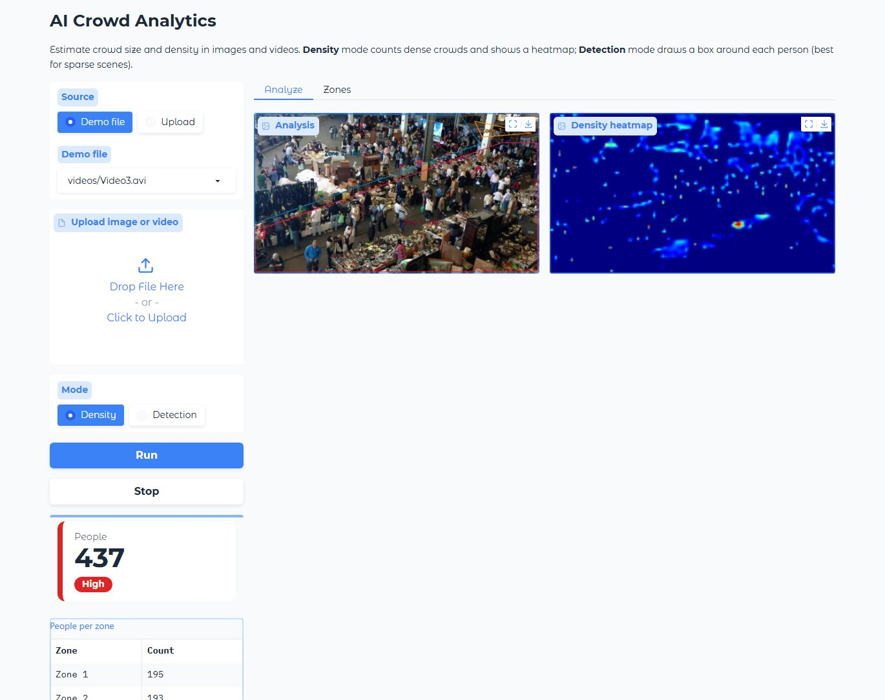
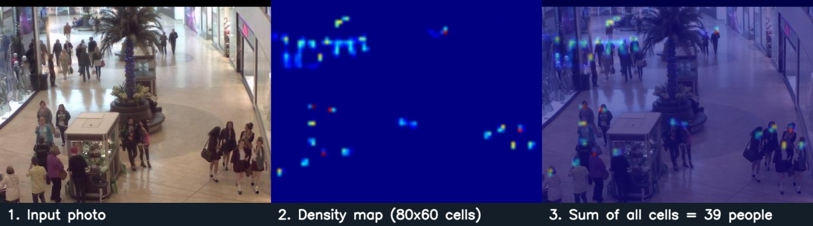
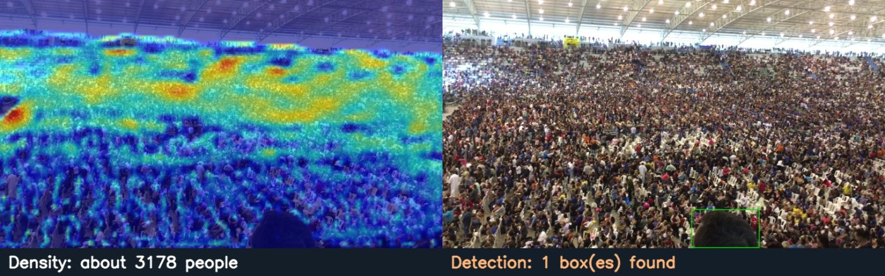
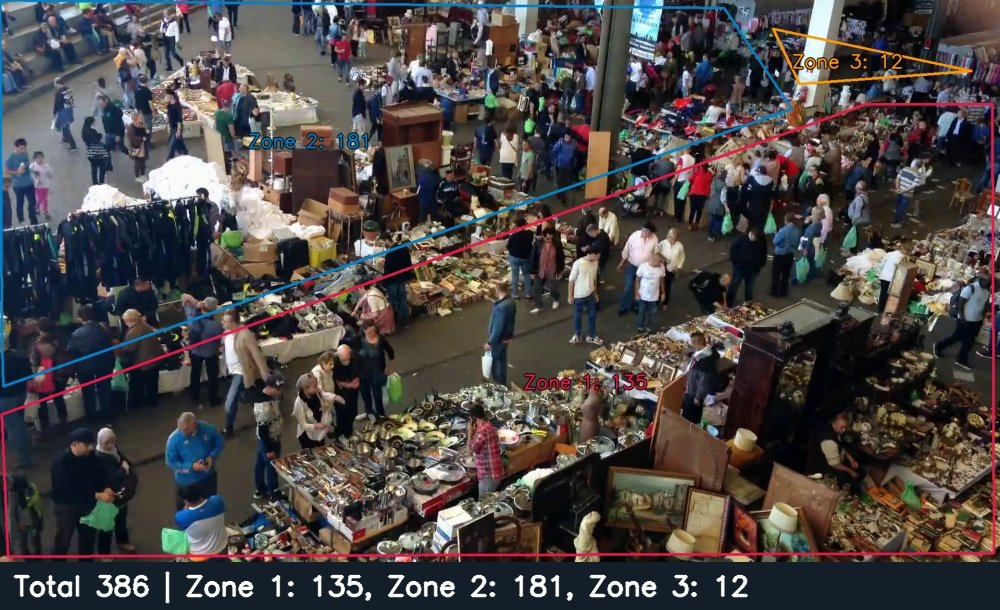
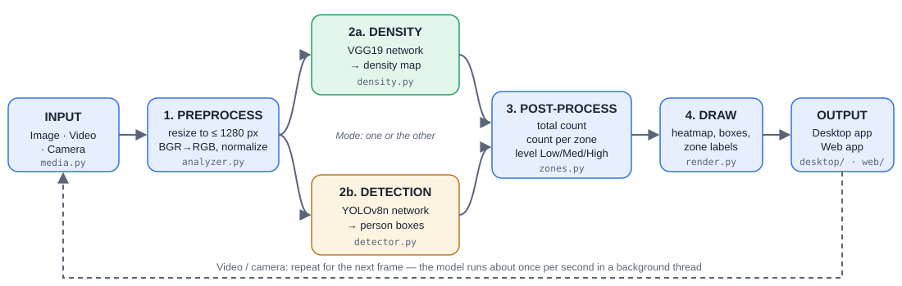
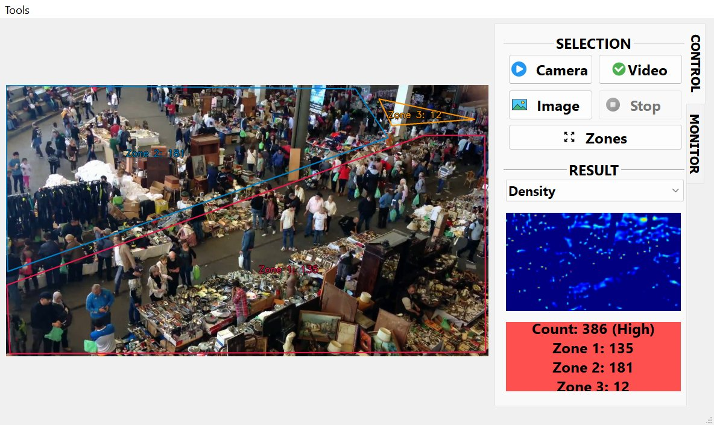
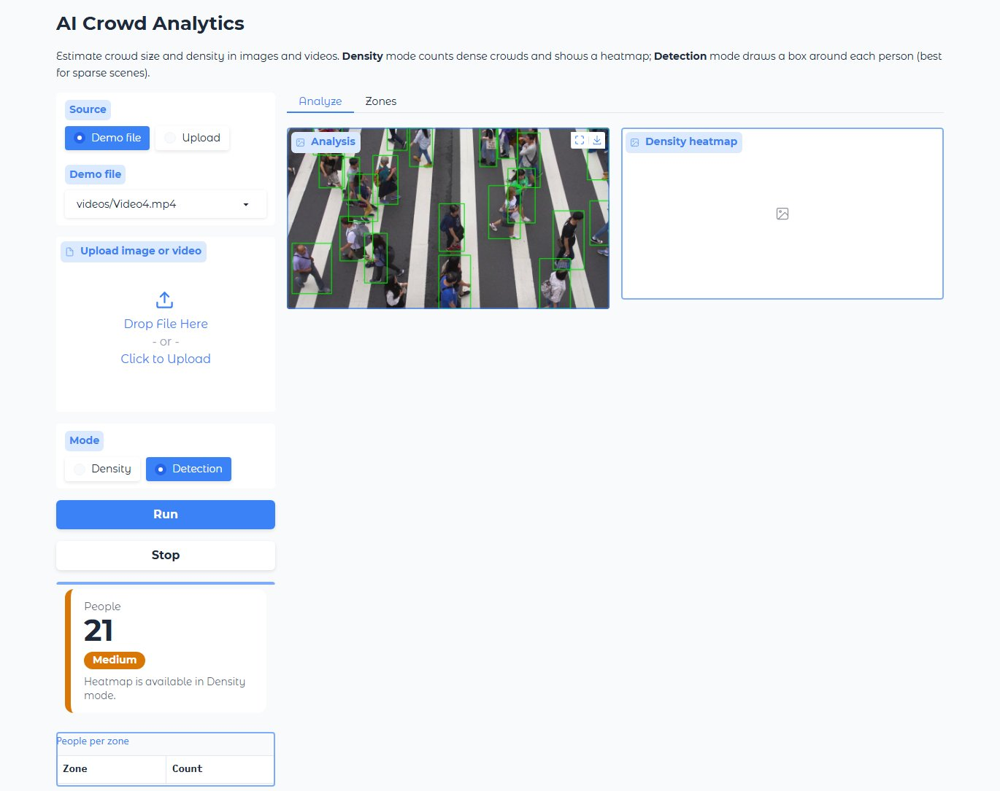
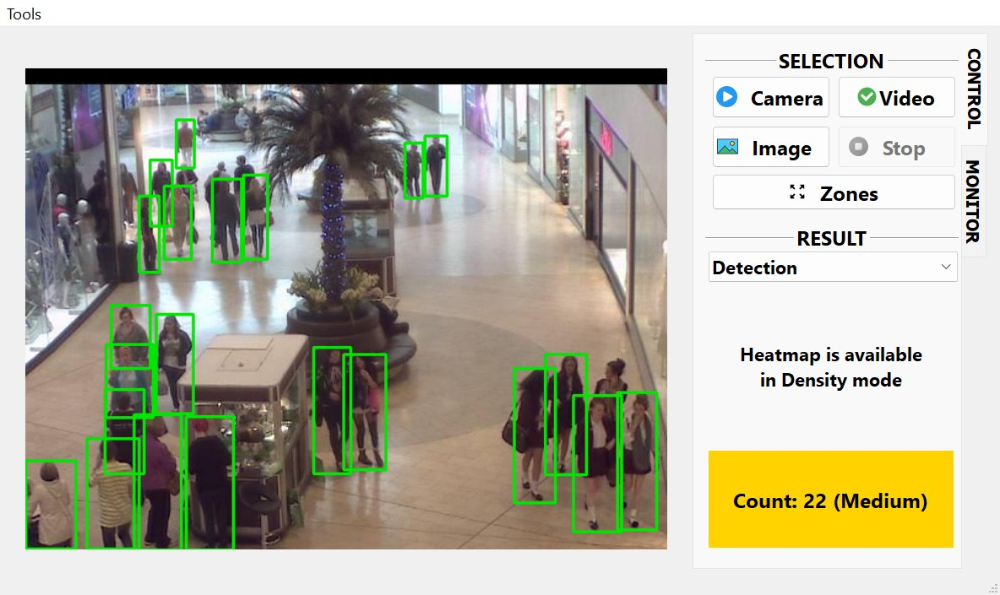
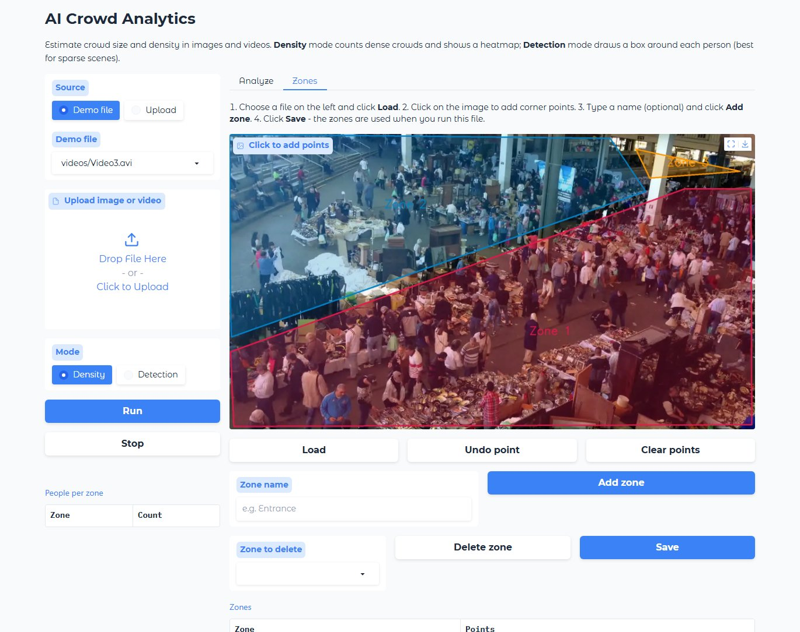
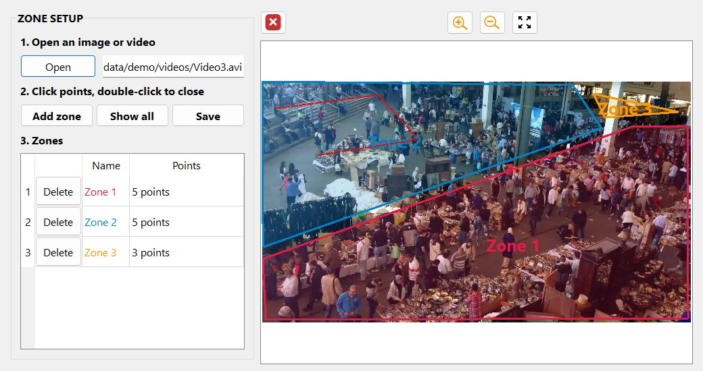

# AI Crowd Analytics

**Count people and find crowded areas in images and videos — with a desktop app and a web app.**




## Overview

Shopping malls, fairs, exhibitions and events need to know **how many people are present** and **which areas get crowded**, to plan staff, layout and safety. AI Crowd Analytics answers both questions from a photo, a video file or a camera:

- **How many people?** A crowd-counting neural network estimates the total, even in packed crowds.
- **Where?** A density heatmap shows hot spots, and user-drawn **polygon zones** (entrance, aisle, stage…) get their own counts.
- **How busy?** Each result is labelled **Low / Medium / High** with configurable thresholds.

The system analyzes **crowds, not individuals**: no face recognition and no identity tracking.

## Features

- **Two AI modes**
  - **Density** — VGG19 density-estimation network → heatmap + count; works for dense crowds.
  - **Detection** — YOLOv8n person detector → a box around each person; best for sparse scenes.
- **Polygon zones** — draw any shape, name it, save it next to the media file; per-zone counts in both modes.
- **Inputs** — images, video files (`.mp4 .avi .mov .mkv .wmv`) and cameras / RTSP streams.
- **Real-time video on a normal CPU** — the model runs in a background thread about once per second, so playback stays smooth.
- **Two interfaces sharing one AI core** — a PyQt5 desktop app and a Gradio web app (both can draw zones).
- **69 automated tests** (pytest), including the GUI and web handlers.

## Results

Real outputs of the app on the demo data (laptop CPU):

| Scene | Density mode | Detection mode |
|---|---|---|
| Shopping mall photo (640×480) | **39** people | 22 boxes (people hidden behind others are missed) |
| Packed stadium, 4K video frame | **≈ 3,178** people | 1 box (each person is only a few pixels tall) |
| Market video with 3 zones | 386 total → Zone 1: 135, Zone 2: 181, Zone 3: 12 | — |
| Speed per frame (CPU) | ≈ 0.7 s | ≈ 0.1 s |

**Density estimation:** the network outputs a map (1/8 of the image size); the sum of all cells is the people count.



**Why two modes?** On a packed stadium, detection fails while density estimation still counts the crowd:



**Counting per zone** on a market video:



## How it works



1. **Preprocess** (`crowd/media.py`, `crowd/analyzer.py`) — read the image or the next video frame, shrink it so the longer side is ≤ 1280 px, convert BGR → RGB and normalize with ImageNet statistics.
2. **Model** — the Mode setting picks one:
   - `crowd/density.py`: VGG19 backbone + regression head from *Bayesian Loss for Crowd Count Estimation* (ICCV 2019) → density map.
   - `crowd/detector.py`: Ultralytics YOLOv8n, class `person`, confidence ≥ 0.35 → boxes.
3. **Post-process** (`crowd/zones.py`) — total count; per-zone count (density cells inside the polygon, or people whose feet are inside it); density level.
4. **Draw** (`crowd/render.py`) — heatmap, person boxes, colored zones with labels; shown by the desktop or web app.

Both apps call the same function, `Analyzer.process(frame, mode, zones)`, so the AI core has no UI code.

## Screenshots

| Desktop app | Web app |
|---|---|
|  |  |
|  |  |
|  | |

## Tech stack

| Area | Tools |
|---|---|
| AI models | PyTorch (VGG19 density network), Ultralytics YOLOv8n |
| Image & video | OpenCV, NumPy |
| Desktop app | PyQt5 (Qt Designer `.ui` files) |
| Web app | Gradio |
| Testing | pytest (offscreen Qt tests, web handler tests) |
| Environment | Miniconda, Python 3.10, CPU only |

## Project structure

```
ai-crowd-analytics/
├── crowd/               # AI core used by both apps (no UI code)
│   ├── analyzer.py      #   runs a model on a frame and builds the result
│   ├── density.py       #   crowd-counting model (density map)
│   ├── detector.py      #   person detector (YOLOv8n)
│   ├── zones.py         #   polygon zones: load/save, count inside
│   ├── media.py         #   read images and video frames
│   └── render.py        #   draw heatmap, boxes and zones
├── desktop/             # desktop app (PyQt5) and its .ui files
├── web/app.py           # web app (Gradio)
├── run_desktop.py       # starts the desktop app
├── weights/             # model files (not in git, see weights/README.md)
├── data/demo/           # demo images and videos (not in git)
├── tests/               # automated tests
├── docs/                # design notes, images, pipeline diagram
└── config.yml           # settings
```

## Setup (step by step, Windows)

### 1. Install Miniconda

1. Download the **Miniconda Windows 64-bit installer**: https://docs.anaconda.com/miniconda/
2. Run it with the default options ("Just Me").
3. Open **Anaconda Prompt (miniconda3)** from the Start menu. Use it for every command below.

### 2. Clone the project

Install **Git for Windows** if needed (https://git-scm.com/download/win), then clone into a folder **without spaces or Vietnamese characters**:

```
mkdir C:\projects
cd C:\projects
git clone https://github.com/dangviethadev/ai-crowd-analytics.git
cd ai-crowd-analytics
```

### 3. Create the environment and install the libraries

```
conda create -n crowd python=3.10 -y
conda activate crowd
pip install -r requirements.txt
```

The download is about 1–2 GB (5–15 minutes). Run `conda activate crowd` every time you open a new prompt.

### 4. Add the model files

Model files are not stored in git (see [`weights/README.md`](weights/README.md)).

- **Detection** (`yolov8n.pt`, public): download it with
  ```
  curl -L -o weights\yolov8n.pt https://github.com/ultralytics/assets/releases/download/v8.3.0/yolov8n.pt
  ```
- **Density** (`crowd_vgg19.pth`): delivered separately by the project owner. Copy it into `weights\`; Density mode turns on automatically. Without it, both apps start in Detection mode.

### 5. Add demo data (optional)

Demo images and videos are not in git. Put your own files (or the demo pack) into `data\demo\images` and `data\demo\videos` — see [`data/README.md`](data/README.md).

### 6. Run the tests (optional)

```
python -m pytest -rs
```

Expected: `69 passed` with both models and the demo data. Tests whose model or data file is missing are **skipped**, not failed; `-rs` shows why.

## Usage

### Desktop app

```
python run_desktop.py
```

1. Choose the **mode** (Density / Detection) above the heatmap.
2. Click **Image**, **Video** or **Camera**. The frame is on the left; heatmap, count and level on the right.
3. **Stop** ends a video or camera. The **MONITOR** tab shows CPU, RAM and disk usage.

### Web app

```
python web/app.py
```

Your browser opens http://127.0.0.1:7860 (stop the server with **Ctrl+C**).

- **Analyze tab:** choose a demo file or **Upload**, pick the mode, click **Run** (and **Stop** for videos).
- **Zones tab:** **Load** the file, click on the image to add corner points, **Add zone**, then **Save**.

### Drawing zones (desktop)

1. Click **Zones** (or menu **Tools > Zone Setup**) and **Open** an image or video (the first frame is used).
2. **Left-click** to add corner points, **double-click** to close the polygon. **Backspace** removes the last point, **Esc** cancels, **right-click** zooms.
3. **Add zone**, rename it in the table if you like, then **Save**. Zones are stored next to the file (`Video3.avi` → `Video3.json`) and used automatically by both apps.

## Configuration (`config.yml`)

| Setting | Meaning | Default |
|---|---|---|
| `camera_source` | Camera index (`0`, `1`) or stream URL | `0` |
| `density_interval_sec` | Seconds between two density-model runs on a video | `1.0` |
| `detection_interval_sec` | Seconds between two detector runs (`0` = as often as possible) | `0.0` |
| `max_side` | Large frames are shrunk to this size before analysis | `1280` |
| `level_thresholds` | Count below `low` = Low, below `high` = Medium, otherwise High | `20`, `100` |
| `detector_conf` | Minimum confidence of a person box | `0.35` |

## Limitations and next steps

- Counts are **estimates**; accuracy depends on camera angle and resolution. Detection under-counts in crowds.
- CPU only: about one density update per second on video.
- Planned: a crowd data table (time, zone, count, level) exported to CSV, count-over-time charts, a heatmap accumulated over a whole video, and a Jupyter notebook explaining the pipeline.

## Troubleshooting

| Problem | Fix |
|---|---|
| `'conda' is not recognized` | Use **Anaconda Prompt (miniconda3)**, not the normal Command Prompt. |
| `ModuleNotFoundError` | Run `conda activate crowd`, and run commands from the project folder. |
| `DLL load failed` when importing torch | Install the Microsoft Visual C++ Redistributable: https://aka.ms/vs/17/release/vc_redist.x64.exe |
| "Detector weights not found" | Download `yolov8n.pt` (Setup step 4). |
| "Density model is not installed" | `weights\crowd_vgg19.pth` is missing — use Detection mode until you have it. |
| A video does not open | Move it to a path without spaces or Vietnamese characters. |
| The app is slow | Increase `density_interval_sec` or lower `max_side` in `config.yml`. |
| Web app: port 7860 in use | Close the other web app window (Ctrl+C), or `set GRADIO_SERVER_PORT=7861` and start again. |

## Credits

- Crowd-counting architecture: Ma et al., *Bayesian Loss for Crowd Count Estimation with Point Supervision*, ICCV 2019 — https://github.com/ZhihengCV/Bayesian-Crowd-Counting
- Person detector: Ultralytics YOLOv8 (AGPL-3.0) — https://github.com/ultralytics/ultralytics
- Mall images: Mall dataset, Chen et al., BMVC 2012 — https://personal.ie.cuhk.edu.hk/~ccloy/downloads_mall_dataset.html
- Other demo videos were used for educational demonstration only and are not distributed with this repository.
